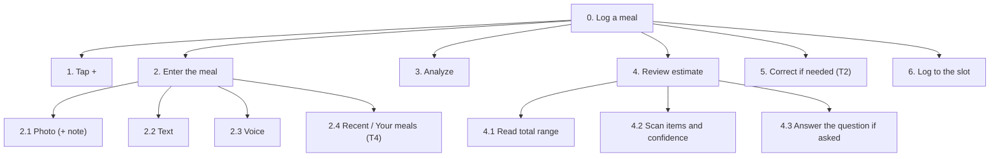
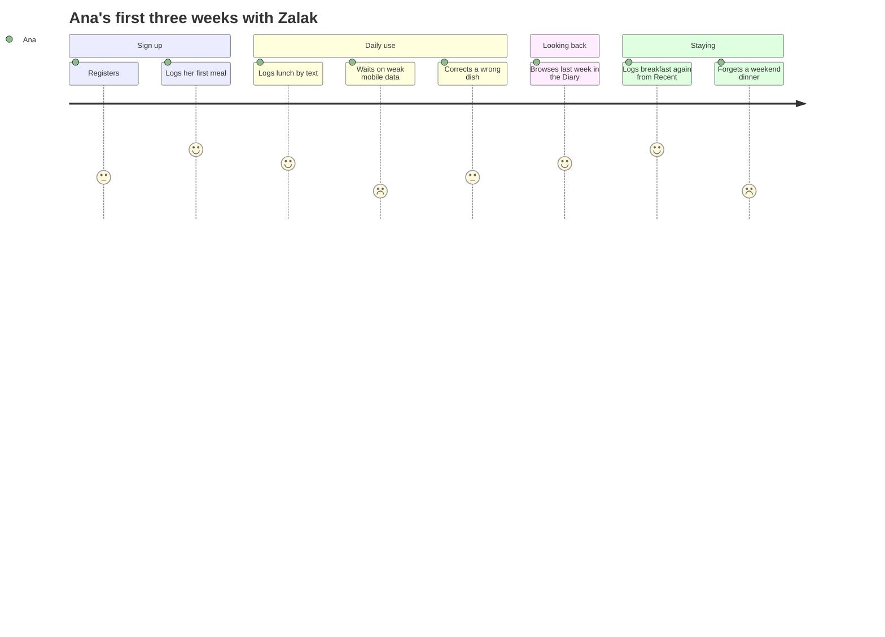

# Zalak: Task Analysis and Experience Modeling

Users don't come to Zalak to "use an interface"; they come to reach a goal (lecture 004). This document covers user goals, the main tasks broken into steps (HTA), scenarios, a user journey and mental models.

## 1. User goals

- **Functional:** log a meal quickly, check a meal before eating, fix a wrong estimate, see how the day went.
- **Experiential:** fast, clear, effortless (no database search, no weighing).
- **Emotional:** trust ("I know what it understood"), calm (no guilt), in control (nothing saved without me).

## 2. Tasks

**Activity:** keeping a rough food journal. Its tasks:
- **T1 Log a meal:** repetitive, so it needs speed and one-tap capture
- **T2 Correct an estimate:** complex, so it needs free editing in any order, not a wizard
- **T3 Check before eating:** simple, under time pressure
- **T4 Re-log a favorite:** repetitive, so it needs a shortcut
- **T5 Finish a draft:** simple
- **T6 Look back at past days:** simple
- **T7 Sign up after a guest check:** simple and rare, but it must not lose the checked meal

## 3. Hierarchical task analysis

### T1 Log a meal

**Plan:** 1 → 2 → 3 → 4 → 5 (only if something is wrong) → 6. The slot is picked from the time and can be changed in step 1 or on Result. The input is saved as a draft before step 3, so an interruption loses nothing. When the AI is right, logging takes 2 interactions after capture (Analyze, Log).

**What can go wrong:**
- a dark photo → "No food found", what Zalak saw, tips; retake or describe it
- an awkward moment for a photo → "Type it instead" on the camera screen
- misheard voice → editable transcript
- slow or failed analysis → progress shown, input kept as a draft, Try again
- an uncertain item missed → marked with an icon, a word and a reason

### T2 Correct an estimate
**Plan:** decide what's wrong, then in any order:
- rename an item, or "Re-estimate" it with Zalak
- change a portion (stepper with fractions, bowl / slice / piece, grams and other units)
- add an item ("Add something Zalak missed")
- remove an item (with Undo)
- or say what was wrong in your own words ("Tell Zalak", typed or spoken)

Totals follow at once. **What can go wrong:** not knowing how big "200 g" is → household measures first, the grams shown as "≈ 200 g"; not noticing items are editable → a pencil on every item.

### Other tasks
- **T3 Check before eating:** + → enter the meal → Analyze → **Just checking** (discard) or Log. A lighter idea may appear. Repeat to compare two options.
- **T4 Re-log a favorite:** + → Recent → **Log again** (1 tap), or Your meals → the meal → **Log to lunch** (2 taps).
- **T5 Finish a draft:** Home → the slot's **To finish** row → it opens where it stopped (Result, or the error page) → Log.
- **T6 Look back:** Diary → page arrows or the calendar → a day → a meal → Meal detail.
- **T7 Sign up after a guest check:** check a meal as a guest → **Log** → "Keep this meal?" → **Create a free account** (2 short steps, the second skippable) → the meal is logged, with Undo.

## 4. Scenarios

Each follows the lecture's elements: user, context, goal, steps, problems.

- **Ana, lunch at the canteen with friends.** Doesn't want to photograph her plate in front of them, so she types "tavče gravče, bread, shopska salad". She gets 650–850 kcal with the oil marked unsure ("Oil is hard to see in a dish"), taps "About that" under its question, and logs it to lunch.
- **Elena, dinner at home.** Photographs pasta with salmon and sees 600–750 kcal with "a filling dinner with good protein". No targets, no red, no judgment.
- **Ivan, in a fast-food queue.** Compares a burger menu (1,100–1,350 kcal) with a wrap (550–700 kcal), discards the first with **Just checking**, orders the wrap and logs it.
- **Marko, meal prep after the gym.** The AI says 150 g of chicken; on Edit item he steps it to 200 g and the protein follows. He hearts the meal and the next day logs it again from Recent in one tap.
- **Lea, Sunday family dinner.** Snaps the musaka tray between children's requests and closes the app. At 22:00 it waits on Home under **To finish**; she opens it, steps the musaka down to ¼ on Edit item (her share), and logs it.
- **Goran, his first meal.** Sees "estimates, not medical advice" at sign-up, three photo tips before his first photo, and logs breakfast within 2 minutes.

## 5. User journey: Ana's first three weeks

Emotion scores: 1 = frustrated, 5 = happy.

**Low points and responses:**
- registration → two short steps, the second skippable
- slow analysis → progress shown, the input kept as a draft, Try again
- a forgotten meal → a past day can still be filled in from the Diary; gaps are never highlighted or punished (no streaks)

## 6. Mental models

How users think the system works, and how Zalak responds:
- **"A food app means searching a database."** → you describe or photograph the meal instead.
- **"A computer gives an exact answer."** → always a range, with a reason when unsure.
- **"AI knows everything."** → a review step before Log makes checking part of the flow.
- **"A portion is a bowl, not grams."** → household measures come first.
- **"A food diary is a notebook."** → the Diary is a book, one page per day, with Your meals at the back.
- **"A photo gives an instant result."** → immediate "analyzing" feedback.

**Principles:**
- familiar metaphors (the diary book, the bitten cookie as progress)
- consistency (the main action bottom-right, Back top-left, the same labels everywhere)
- predictability (Analyze always shows progress)
- minimal effort (no training needed)

## 7. Tasks for a usability test

Written for a test with 3–5 people; the test itself was not run.
1. At the canteen with friends, log your lunch without a photo. *(T1)*
2. Log this photo; the app says 150 g of chicken, but it was 200 g. Fix it. *(T1, T2)*
3. Find out which of two fast-food meals is lighter, then log only the one you choose. *(T3)*
4. Log yesterday's breakfast again from your recent meals. *(T4)*
5. Finish the dinner photo you didn't log, as a quarter of the dish. *(T5)*
6. Check a meal without an account, then log it, signing up when asked. *(T7)*
