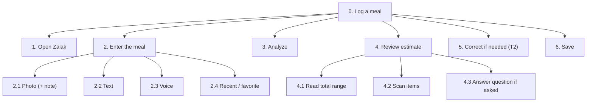
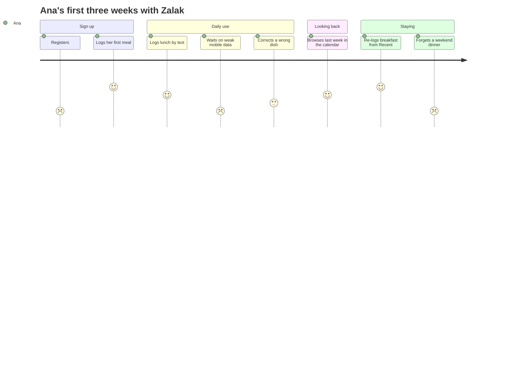

# Zalak: Task Analysis and Experience Modeling

Users don't come to Zalak to "use an interface"; they come to reach a goal (lecture 004). This document covers user goals, the main tasks broken into steps (HTA), scenarios, a user journey and mental models.

## 1. User goals

- **Functional:** log a meal quickly, check a meal before eating, fix a wrong estimate, see how the day went.
- **Experiential:** fast, clear, effortless (no database search, no weighing).
- **Emotional:** trust ("I know what it understood"), calm (no guilt), in control (nothing saved without me).

## 2. Tasks

**Activity:** keeping a rough food journal. Its tasks:
- **T1 Log a meal:** repetitive, so it needs speed and one-tap capture
- **T2 Correct an estimate:** complex, so it needs free editing in any order, not a wizard
- **T3 Check before eating:** simple, under time pressure
- **T4 Re-log a favorite:** repetitive, so it needs a shortcut
- **T5 Finish a draft:** simple
- **T6 Look back at past days:** simple
- **T7 Sign up after a guest check:** simple and rare, but it must not lose the checked meal

## 3. Hierarchical task analysis

### T1 Log a meal

**Plan:** 1 → 2 → 3 → 4 → 5 (only if something is wrong) → 6. If the user is interrupted after step 2, the input is kept as a draft. When the AI is right, it takes 2 interactions after capture.

**What can go wrong:**
- a dark photo → explained, retake or type
- an awkward moment for a photo → text is always next to the camera
- misheard voice → editable transcript
- slow or failed analysis → progress shown, input kept, retry
- an uncertain item missed → visibly marked

### T2 Correct an estimate
**Plan:** decide what's wrong, then in any order:
- replace a food
- change a portion (sizes, bowl/slice/piece, grams)
- add an item
- remove an item (with undo)

The total updates instantly.
**What can go wrong:** not knowing how big "200 g" is → household measures first; not noticing items are editable → an edit icon on every item.

### Other tasks
- **T3 Check before eating:** enter the meal → Analyze → "Just checking" (discard) or Save. Can repeat to compare two options.
- **T4 Re-log a favorite:** tap it in Recent/Favorites → adjust the portion if needed → Save (2 taps).
- **T5 Finish a draft:** drafts stay on Today marked "to finish" → tap → analyze → save.
- **T6 Look back:** Today screen → calendar → a day → a meal.
- **T7 Sign up after a guest check:** check a meal as a guest → tap Log → short sign-up (skippable steps) → the meal is logged.

## 4. Scenarios

Each follows the lecture's elements: user, context, goal, steps, problems.

- **Ana, lunch at the canteen with friends.** Doesn't want to photograph her plate in front of them, so she types "tavče gravče, bread, shopska salad" under the table. She gets 650–850 kcal with the oil marked as uncertain, and saves.
- **Elena, dinner at home.** Photographs pasta with salmon and sees 600–750 kcal with "a filling dinner with good protein". No targets (she left them off), no red, no judgment.
- **Ivan, in a fast-food queue.** Compares a burger menu (1,100–1,350 kcal) with a wrap (550–700 kcal), discards the first with "Just checking", orders the wrap and saves it.
- **Marko, meal prep after the gym.** The AI says 150 g of chicken; he changes it to 200 g and protein updates instantly. He saves it as a favorite and re-logs it the next day in 2 taps.
- **Lea, Sunday family dinner.** Snaps the musaka tray as a draft between children's requests. At 22:00 she finishes it as "my share: ¼".
- **Goran, his first meal.** Sees "estimate, not medical advice" and three photo tips, and "kcal" is explained the first time. He logs breakfast within 2 minutes.

## 5. User journey: Ana's first three weeks

Emotion scores: 1 = frustrated, 5 = happy.

**Low points and responses:**
- registration → short sign-up
- slow analysis → progress shown and the input kept as a draft
- a forgotten meal → gaps are never highlighted or punished (no streaks)

## 6. Mental models

How users think the system works, and how Zalak responds:
- **"A food app means searching a database."** → you describe or photograph the meal instead.
- **"A computer gives an exact answer."** → always a range, with a reason.
- **"AI knows everything."** → a review step before saving makes checking part of the flow.
- **"A portion is a bowl, not grams."** → household measures come first.
- **"A food diary is a notebook."** → Today is the current page; the calendar holds the earlier pages.
- **"A photo gives an instant result."** → immediate "analyzing" feedback.

**Principles:**
- familiar metaphors
- consistency (Save, Cancel and Back always in the same place)
- predictability (Analyze always shows progress)
- minimal effort (no training needed)

## 7. Tasks for usability testing

1. At the canteen with friends, log your lunch without a photo. *(T1)*
2. Log this photo; the app says 150 g of chicken, but it was 200 g. Fix it. *(T1, T2)*
3. Find out which of two fast-food meals is lighter, then save only the one you choose. *(T3)*
4. Log yesterday's breakfast again from your recent meals. *(T4)*
5. Finish the dinner photo you didn't log, as a quarter of the dish. *(T5)*
6. Check a meal without an account, then log it, signing up when asked. *(T7)*
