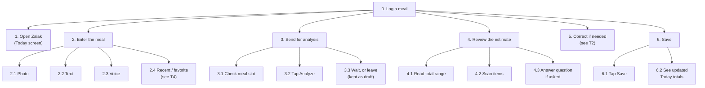
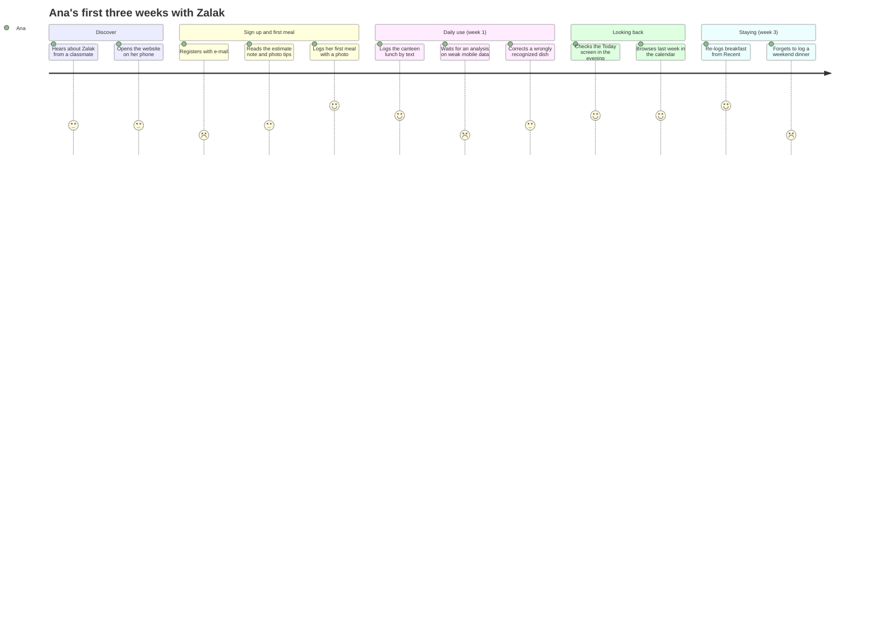

# Zalak: Task Analysis and Experience Modeling

Users don't come to Zalak to "use an interface"; they come to reach a goal (lecture 004). This document describes those goals, breaks the main tasks into steps (hierarchical task analysis), tells the personas' stories as scenarios, maps one user journey, and compares users' mental models with how Zalak works.

It builds on `01-problem-analysis.md` (design implications D1–D14) and `02-user-research-and-requirements.md` (personas, insights I1–I9, requirements FR/NFR).

## 1. User goals

The lecture distinguishes three types of goals.

**Functional goals** (what users want to get done)
- Log what they ate quickly.
- Find out roughly how much a meal is before eating it.
- Fix the estimate when the AI gets something wrong.
- See how today, or the last few days, went.

**Experiential goals** (how using the app should feel)
- Fast: logging takes seconds, not minutes.
- Clear: the result is understood at a glance.
- Effortless: no searching through food databases, no weighing food.

**Emotional goals** (what users want to feel)
- Trust: "I know what the app understood, and I can fix it."
- Calm: no guilt, no judgment, no pressure.
- In control: "nothing is saved or decided without me."

## 2. Activities, tasks and actions

**Activity:** keeping a rough food journal.
It consists of the following tasks:

| Task | Type | Personas |
|---|---|---|
| T1 Log a meal | Repetitive (several times a day) | everyone |
| T2 Correct an estimate | Complex (decisions, not a fixed order) | Marko, Lea, everyone |
| T3 Check a meal before eating | Simple, under time pressure | Ivan |
| T4 Re-log a favorite meal | Repetitive | Marko, Ana |
| T5 Finish a draft | Simple | Lea |
| T6 Look back at today or past days | Simple | Ana, Elena, Lea |
| T7 Change the display mode | Simple, rare | Elena |

**Actions** are the single interactions inside these tasks, e.g. "tap the camera button", "tap Save".

What the task types mean for the design (lecture):
- **Repetitive tasks (T1, T4)** need speed, shortcuts and quick access: one-tap capture on the home screen, recent and favorite meals.
- **Complex tasks (T2)** need flexibility, not a wizard: users decide what's wrong and fix it in any order.
- **Simple, rare tasks (T7)** only need to be easy to find and remember.

## 3. Hierarchical task analysis (HTA)

Each task is broken into subtasks and steps. A **plan** says in which order they happen. Each HTA ends with what can go wrong and which requirement handles it.

### T1 Log a meal

**Steps in detail**
- 1 Open Zalak. The Today screen opens, with the capture buttons at the bottom within thumb reach.
- 2 Enter the meal, using one of:
  - 2.1 Photo: tap the camera → frame the plate → take the photo (or pick one from the gallery)
  - 2.2 Text: tap the text field → type, e.g. "two eggs, a slice of bread, hummus and yogurt"
  - 2.3 Voice: tap the microphone → speak → check and edit the recognized text
  - 2.4 Recent or favorite: tap the meal → skip to 4
- 3 Send for analysis
  - 3.1 Check the meal slot (pre-filled from the time of day)
  - 3.2 Tap Analyze
  - 3.3 Wait while progress is shown, or leave; the input is kept as a draft
- 4 Review the estimate
  - 4.1 Read the total (a range, or a description in Numbers-light mode)
  - 4.2 Scan the item list; uncertain items are marked with a reason
  - 4.3 Answer a clarifying question, if the system asks one
- 5 Correct anything wrong (T2)
- 6 Save
  - 6.1 Tap Save
  - 6.2 See the confirmation and the updated Today totals

**Plan:** 1 → 2 (one of 2.1–2.4) → 3 → 4 → 5 only if something is wrong → 6. If the user is interrupted any time after step 2, the input is kept as a draft (T5).

**Count when the AI is right:** capture, then *Analyze*, then *Save*: 2 interactions after capture, within NFR6 (at most 3).

**What can go wrong**
- The photo is too dark or shows no food → explained, retake or type instead (FR30, FR31).
- Photographing feels awkward with others around → text and voice are always next to the camera button (FR6, FR7).
- Voice recognized wrongly → the transcript is editable before sending (FR7).
- The analysis is slow or fails → progress shown, input kept, retry or type instead (NFR2, FR29, NFR21).
- The user saves without noticing an uncertain item → uncertain items are visibly marked (FR14).

### T2 Correct an estimate

- 1 Decide what is wrong: the food itself, the portion, a missing item, or an extra item
- 2 Fix a wrong food: tap the item → pick a suggested alternative or type the right name
- 3 Fix a portion: tap the portion → use the stepper, a preset size (small/medium/large), a household measure (bowl, slice, spoon, piece) or grams
- 4 Add a missing item: tap "+ Add item" → type it → the system estimates it
- 5 Remove an extra item: tap remove → undo is available for a few seconds
- 6 Check the new total, which updates immediately

**Plan:** 1, then any of 2–5, in any order and as often as needed, then 6. This is the "not well-defined" task from the PACT analysis, so it uses direct editing on the review screen, not a step-by-step wizard.

**What can go wrong**
- Users don't know how big "200 g" is → household measures and preset sizes (FR19).
- Users don't notice that items can be edited → each item looks tappable (an edit icon, not just text).
- Removing an item by accident → undo (FR21, FR25).
- Users change something and lose track of the total → the total updates within 100 ms (FR22, NFR4).

### T3 Check a meal before eating

- 1 Open Zalak
- 2 Enter the meal by photo or text (T1 step 2)
- 3 Tap Analyze and read the range
- 4 Decide:
  - 4.1 "Just checking": discard without saving, or check another option
  - 4.2 Ate it: Save

**Plan:** 1 → 2 → 3 → 4. Steps 2–3 may repeat to compare two options.

**What can go wrong**
- Accidentally saving a meal that was only checked → nothing is saved without Save (FR23), and a clear "Just checking" option discards it (FR34).
- No time to wait → the result is shown as soon as possible, with progress feedback (NFR3).

### T4 Re-log a favorite meal

- 1 Open Zalak
- 2 Tap the meal in the Recent / Favorites row
- 3 Adjust the portion if needed (T2 step 3)
- 4 Tap Save

**Plan:** 1 → 2 → 3 if needed → 4. Without adjustment this takes 2 taps (NFR8).

### T5 Finish a draft

- 1 Open Zalak; drafts are shown on Today with a "to finish" label
- 2 Tap the draft
- 3 Add a description if it is only a photo (optional)
- 4 Analyze, review and correct (T1 steps 3–5)
- 5 Save

**What can go wrong:** forgetting the draft → it stays visible on Today until finished or deleted.

### T6 Look back

- 1 See today's meals and totals on the Today screen
- 2 Open the calendar → pick a day → see that day's meals with photos
- 3 Open a meal to see or edit its details

### T7 Change the display mode

- 1 Open Profile
- 2 Open Display
- 3 Choose Standard or Numbers-light (a small preview shows the difference)
- 4 Go back; the change applies immediately

**What can go wrong:** users who would benefit never find it → one-time hint after the first meals (FR32).

## 4. Scenarios

Scenarios are short stories of real situations. Each one follows the lecture's elements: **user, context, goal, steps, possible problems**, plus how Zalak handles them.

### Ana: lunch at the canteen with friends
- **Context:** weekday, 13:00, faculty canteen, sitting with three friends. Phone in one hand, fork in the other.
- **Goal:** log lunch without making it a thing in front of her friends.
- **Steps:** She opens Zalak under the table and types "tavče gravče, bread, shopska salad". She taps Analyze, keeps talking, and looks back a few seconds later: 650–850 kcal, with the beans marked "amount of oil unsure". She taps Save.
- **Possible problems:** taking a photo would feel awkward; a local dish might not be recognized; the oil makes the estimate uncertain.
- **Zalak:** text input sits next to the camera (FR6); the estimate is a range with the uncertain item explained (FR13, FR14); she can keep talking while it analyzes (NFR2).

### Elena: dinner at home, without numbers
- **Context:** evening, her kitchen table, relaxed. Numbers-light mode is on.
- **Goal:** stay aware of what she eats without seeing calorie numbers.
- **Steps:** She takes a photo of pasta with salmon and salad and taps Analyze. Zalak shows "A filling dinner with good protein" and a simple bar of protein, carbs and fat. She taps Save.
- **Possible problems:** the app could still push numbers at her or praise and blame her choices.
- **Zalak:** Numbers-light shows descriptions, with exact values only on tap (FR15); no judgmental words or red/green colors anywhere (NFR23).

### Ivan: choosing what to order
- **Context:** in the queue at a fast-food place, 2 minutes until he orders, one hand free.
- **Goal:** compare two menus before deciding.
- **Steps:** He types "double burger menu with fries and cola" and sees 1,100–1,350 kcal. He taps "Just checking", types "chicken wrap with salad and water" and sees 550–700 kcal. He orders the wrap and taps Save on the second estimate.
- **Possible problems:** no time to wait; he doesn't want the burger saved in his journal.
- **Zalak:** quick text input and visible progress (NFR2, NFR3); nothing is saved without Save, and "Just checking" discards the estimate (FR23, FR34).

### Marko: meal prep after training
- **Context:** home after the gym, five boxes of chicken, rice and broccoli on the counter.
- **Goal:** log the meal accurately for his protein target, then repeat it quickly all week.
- **Steps:** He takes a photo of one box. Zalak estimates 150 g of chicken; he knows it is 200 g, taps the portion and changes it. Protein updates immediately. He saves it and marks it as a favorite. The next day he taps it in Favorites and saves: two taps.
- **Possible problems:** the AI underestimates the portion; logging the same meal five times.
- **Zalak:** grams available for experienced users (FR19); instant recalculation (FR22, NFR4); favorites (FR10, FR27, NFR8).

### Lea: a family dinner, finished later
- **Context:** Sunday dinner, a tray of musaka for the whole family, children asking for things.
- **Goal:** log her own portion without interrupting dinner.
- **Steps:** She takes a quick photo of the tray and puts the phone away; it is saved as a draft. At 22:00 she opens Zalak, sees the draft marked "to finish", taps it, sets "my share: ¼ of the tray", reviews the estimate and saves.
- **Possible problems:** the photo shows the whole tray, not her plate; she is interrupted; she might forget.
- **Zalak:** drafts (FR9) shown on Today until finished; "my share" of a shared dish (FR11).

### Goran: his first meal in the app
- **Context:** at home in the morning, reading glasses on, has just registered.
- **Goal:** log breakfast to start following his doctor's advice.
- **Steps:** Zalak shows a short note that values are estimates, not medical advice. Before his first photo it shows three tips (good light, whole plate, from above). He photographs his breakfast; the result shows "kcal" with a short explanation the first time. He saves it and sees his Today screen.
- **Possible problems:** small text, unfamiliar terms, treating the estimate as exact or as medical advice.
- **Zalak:** accessible text and touch targets (NFR11, NFR13); terms explained on first use (NFR24); estimate note (FR33); photo tips (FR31); first meal within 2 minutes (NFR5).

## 5. User journey: Ana's first three weeks

The journey shows the whole experience over time, including emotions (lecture 004). Scores: 1 = frustrated, 5 = happy.

| Phase | What Ana does | Touchpoint | Feeling | Problem | Opportunity |
|---|---|---|---|---|---|
| Discover | Hears about Zalak, opens it on her phone | word of mouth, browser | curious | doesn't know if it's "another MyFitnessPal" | the first screen says what is different: photo, text or voice, no database search |
| Sign up and first meal | Registers, logs the first meal | sign-up form, camera | slightly impatient, then pleased | registration is a barrier | short form; first meal within 2 minutes (NFR5, I8) |
| Daily use | Logs 2–3 meals a day, by text when with friends | Today screen, text field | satisfied | slow analysis on weak data; a dish recognized wrongly | progress and draft saving (NFR2, NFR21); easy correction (FR18) |
| Looking back | Checks today and last week | Today, calendar | reflective | none | photos as memory cues (FR26) |
| Staying | Re-logs regular meals, sometimes forgets | Recent row | relaxed; slightly guilty after forgetting | a gap in the journal | gaps are never highlighted or "punished"; no streaks (D7) |

## 6. Mental models

A mental model is how users think a system works, based on what they already know. When Zalak matches it, the app feels intuitive; when it doesn't, users get confused (lecture 004).

**What users bring with them, and how Zalak responds**

- **"A food app = search a database and enter grams"** (Marko, Ana's MyFitnessPal experience).
  Zalak works differently: you describe or photograph the meal. → The first screen and the capture buttons make this obvious; grams remain available for those who want them (FR19).

- **"A computer gives an exact answer"** (Goran, Ivan).
  Users may read 650 kcal as a fact. → Zalak always shows a range and explains uncertain items (FR13, FR14); a short note explains why (FR33). Matches **I2** and is checked by NFR9.

- **"AI knows everything"** (Ivan).
  Users may not check the result at all. → Uncertain items are marked, and the review screen comes before saving, so checking is part of the flow (FR14, FR23).

- **"A portion is a plate, a bowl or a slice, not grams"** (Ana, Lea, Goran).
  → Portions are shown and edited in household measures and preset sizes first (FR19).

- **"A food diary is a notebook, one page per day"** (Elena, Lea).
  → Familiar metaphor: Today is the current page; the calendar is the earlier pages (T6).

- **"Taking a photo = instant result"** (from camera, Google Lens and Instagram).
  The analysis takes several seconds. → Immediate "analyzing" feedback and the option to leave (NFR2, FR9).

- **"Deleting is permanent"** (most users) versus apps with a recycle bin.
  → Deletion shows an undo option for a few seconds, and the button says what will happen (FR25).

**Design principles from mental models** (lecture 004)
- **Familiar metaphors:** diary pages, household portions, a camera button that looks like a camera.
- **Consistency:** Save, Cancel and Back are always in the same place; editing works the same way for every item.
- **Predictability:** tapping Analyze always shows progress; tapping Save always shows the meal in Today.
- **Minimal cognitive effort:** no training needed; the first meal can be logged without instructions.

## 7. Changes to the requirements

The task analysis found two gaps, now added to `02-user-research-and-requirements.md`:

- **FR19 (extended)** Portions can also be set in household measures (bowl, slice, spoon, piece), not only small/medium/large or grams. *(mental model: portions are not grams)*
- **FR34 (new, Should)** The user can check a meal's estimate and discard it with "Just checking", without saving it. *(T3, Ivan)*

## 8. Tasks for usability testing

The lecture notes that task analysis defines the real tasks for usability testing (lecture 009). These will be used to test the Figma prototype and the final app:

1. You are at the canteen with friends. Log your lunch without taking a photo. *(T1, text)*
2. Log the meal in this photo. The app thinks it's 150 g of chicken, but it was 200 g. Fix it. *(T1, T2)*
3. You're deciding between two meals at a fast-food place. Find out which is lighter, then save only the one you choose. *(T3)*
4. Log yesterday's breakfast again from your recent meals. *(T4)*
5. You took a photo at dinner but didn't finish logging it. Finish it now and log only a quarter of the dish. *(T5, FR11)*
6. You'd prefer to see descriptions instead of numbers. Change that. *(T7)*
