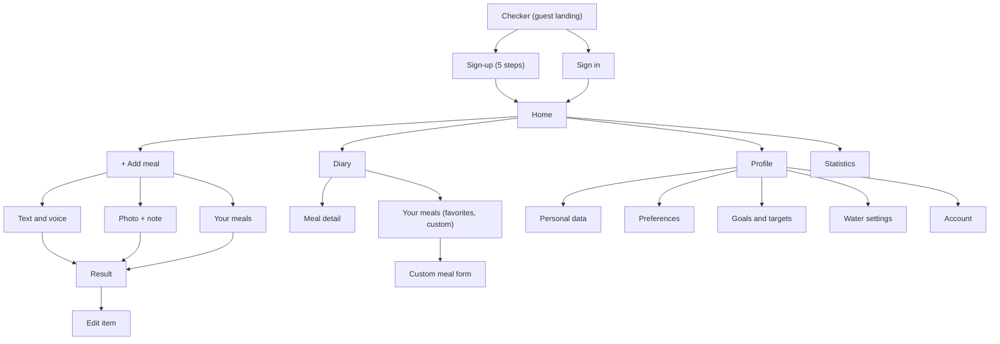
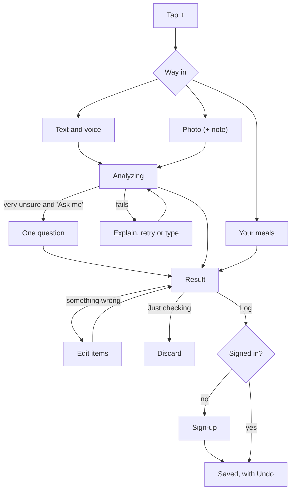

# Zalak: Structure and Interaction

How Zalak's content is organized and how users move through it (lecture 005, information architecture), and how each interaction behaves (lecture 006, interaction design).

## 1. Information architecture (lecture 005)

IA looks at three things: **users** (personas in `02`), **context** (PACT in `01`) and **content** (below). The goal is that users find everything without thinking about the structure, and that logging takes as few steps as possible.

### Content inventory

**Content objects** (principle of objects: each has attributes and can be reused):
- **Meal:** photo and/or text, date, meal slot, food items, total range, macros, status (draft, logged), favorite flag
- **Food item:** name, portion, unit, calorie range, macros, confidence (sure / likely / unsure), reason
- **Custom meal:** a saved meal used as a template ("Your meals")
- **Profile:** name, height, weight, activity level; preferences (uncertainty, AI food preferences, lighter-idea card on/off, meal slots); optional goals and targets
- **Water:** glasses per day, daily amount

**Screens**
- **Entry:** Checker (guest landing), Sign in, Sign-up (5 steps)
- **Checker:** Add meal ("+"), Text and voice, Photo (with note and Tips), Your meals picker, Analyzing, Result, Edit item
- **Home:** week strip, dashboards (calories, macros, water), meal slots
- **Diary:** day pages with photos, quick calendar, Your meals (favorites and custom meals), meal detail, custom meal form
- **Statistics:** opened from the dashboards
- **Profile:** personal data, preferences, goals and targets, water settings, account (password, delete account), about ("estimate, not medical advice")

### Organization

- **Chronological** is the main scheme: users think in days ("what did I eat today?"). Home and Diary are organized by date, then by meal slot.
- **Sequential** where order matters: the checker (input → analyzing → result → log) and the sign-up wizard.
- **Hierarchical, but shallow:** every screen is at most two taps from Home.
- **Multiple classification:** a past meal can be reached by date (Diary), by name (Your meals) or from Recent in the "+" sheet.

### Sitemap

### Navigation

**Main navigation** (principle of focused navigation: few options, each with one clear purpose):
- **Platform:** a responsive web app, mobile-first, installable to the home screen (PWA). Designed at 390 × 844 (phone) and 1440 px (desktop); tablets use the phone layout, stretched.
- **Mobile:** a bottom bar with **Home · Diary · Statistics** and a raised **"+"** in the bottom-right corner, the easiest spot for the thumb. Profile is the icon at the top right of Home, as in the design wants.
- **Desktop:** the same items in a left sidebar, with "+ Add meal" as the top button and Profile at the bottom. The extra width shows more detail: on Result, the photo on the left and the items on the right; on Home, a weekly summary beside the dashboards.

**Secondary navigation:**
- the week strip, arrows and small calendar (Home)
- the quick calendar (Diary)
- tapping a dashboard opens that part of Statistics (calories, macros or water)
- the "+" next to each meal slot opens Add meal with that slot preselected

**Guests:** a guest lands directly on the Checker (D14), with a small "Sign in" link at the top. They see no bottom bar, because Home and Diary have nothing to show without an account. Tapping Log starts sign-up, and the meal is logged once sign-up is done.

### User flows

The core flow: checking and logging a meal.

Other flows, in steps:
- **Re-log a favorite:** + → Your meals → tap the meal → Log (meets NFR8, ≤2 taps after opening).
- **Finish a draft:** Home → the meal slot marked "To finish" → Analyze → Result → Log.
- **Look back:** Diary → swipe or calendar → day → meal detail → edit.
- **Change the uncertainty preference:** Profile → Preferences → "When unsure".

### Labels

Each name is used once and the same everywhere (terminology consistency, lecture 006):
- **Home** (not "Today" or "Dashboard")
- **Diary** (not "Journal" or "History")
- **Your meals:** favorites and custom meals together, in both the "+" sheet and the Diary
- **Just checking** and **Log** as the two result actions
- **To finish** for drafts
- **Tips** for the photo tutorial
- confidence words: **sure, likely, unsure**

### Dan Brown's eight principles

- **Objects:** meals and food items are reusable objects (a logged meal becomes a custom meal).
- **Choices:** three main destinations plus "+", and three ways into "+".
- **Disclosure:** summary first (the total range), with items, macros and reasons on tap.
- **Exemplars:** each input shows an example ("e.g. tavče gravče and a shopska salad").
- **Front doors:** every screen shows where you are (an active tab, a title) and a way back to Home.
- **Multiple classification:** past meals can be found by date, by name and through Recent.
- **Focused navigation:** the bottom bar is for main places, the week strip for time, and in-page links for details.
- **Growth:** new meal slots, Statistics cards and preferences fit without changing the structure.

### Tree test

A quick test with 3–5 people, run on the sitemap before any design. For each question, note where they would tap first:
1. Where would you add your lunch?
2. Where would you see what you ate last Tuesday?
3. Where would you change how Zalak handles uncertain food?
4. Where would you find a meal you saved as a favorite?
5. Where would you see your protein for the week?

Question 3 is the riskiest, because Preferences sits inside Profile.

## 2. Interaction design (lecture 006)

Interaction design decides how Zalak **behaves**: how users start actions and how the system responds. Visual style comes later, in `06`.

### The five dimensions in Zalak

- **Words:** short, action-based labels ("Log to lunch", not "Submit"). Errors say what happened and what to do next. Neutral tone: never "good/bad", "cheat" or "over the limit".
- **Visual representations:** familiar icons with a label (camera, microphone, pencil for edit, trash for delete). Confidence is an icon **and** a word, never color alone.
- **Physical space:** a phone in one hand, often while eating. Main actions sit in the bottom thumb zone, and targets are at least 44 × 44 px. On desktop, everything also works with mouse and keyboard.
- **Time:** an analyzing animation, short transitions between steps, an undo message that stays about 5 seconds, and totals that change instantly when you edit.
- **Behaviour:** tap to open, swipe to change days. The same gesture does the same thing everywhere.

### Norman's principles applied

- **Visibility:** the three ways in are always visible on the "+" sheet, never hidden in a menu. The result always shows which meal slot it will be logged to.
- **Feedback:** every tap responds within 1 s. The microphone pulses while listening, "Analyzing…" shows progress, and "Logged to lunch · Undo" confirms the save.
- **Constraints:** Log is disabled until the result is ready, and the portion stepper never goes below zero. The date picker can't choose a future date for logging. Analyze stays disabled while the text field is empty.
- **Affordances and signifiers:** each food item is a card with a chevron and a pencil icon, so it looks tappable. The day strip has a peeking edge, so it looks swipeable (closure, lecture 007). The "+" is raised above the bar, so it looks pressable.
- **Mapping:** the portion stepper puts − on the left and + on the right, and the total updates right next to it. A "+" on a meal slot adds to that slot.
- **Consistency:** Log and Just checking are always in the same place at the bottom of Result. Bottom sheets always close by swiping down or tapping outside. The labels follow the list in section 1.
- **Discoverability:** placeholder examples in the text field, tips cards on first photo use, and a "Tips" button afterwards.
- **Conceptual model:** "the AI proposes, you decide". Nothing is saved until you tap Log, matching the mental models in `03`.
- **Error prevention and recovery:** input is saved as a draft before analysis. Undo is offered after logging and deleting. A failed analysis keeps the input and offers Retry or "Type it instead".

### Key interactions

**Add meal ("+")**
- A bottom sheet with three large options: **Text and voice**, **Photo**, **Your meals**. Recent meals are listed below them.
- It is opened from the corner "+" (meal slot guessed from the time of day) or from a meal slot's "+" (slot already chosen).

**Text and voice**
- One text field with the microphone button inside it.
- The microphone has three states: idle, listening (pulsing, words appear live), done (the text can be edited).
- If voice isn't supported (Firefox), the microphone is hidden and the field still works.
- This also covers the AI discoverability problem from the lecture (an empty prompt box): the placeholder gives an example ("e.g. two eggs, toast with butter, coffee with milk") and quick chips suggest what to add ("portion", "how it was cooked").

**Photo**
- Camera or upload, then an optional note field under the preview ("anything the photo can't show?").
- The first time, swipeable tips cards: good light, the whole plate, one plate at a time. They include "Don't show again".

**Analyzing**
- Appears within 1 s. It's a thinking indicator with changing short messages ("Looking at your photo…", "Estimating portions…"), as the lecture recommends for AI waits.
- Cancel is always available. If the user leaves, the input stays as a draft marked "To finish".

**Clarifying question** (only with "Ask me when unsure")
- One question as a card with answer chips ("Was the sauce yogurt or mayonnaise?"), plus "Skip, make your best guess".

**Result**
- From top to bottom: the photo or text, the **total range** (largest), a short neutral description, macros, then the food items.
- Each item shows its name, portion, calorie range, and confidence with a reason when unsure.
- When only checking, a dismissible "lighter idea" card appears.
- Fixed at the bottom: **Just checking** and **Log to [slot]**, plus "Save as my meal" in a small menu.

**Edit item**
- A bottom sheet with the name (editable, with suggestions), the portion (stepper, household measures such as bowl, slice or piece, or grams) and Delete.
- The total on Result updates instantly behind the sheet.
- "Add item" is at the end of the list.

**Log**
- A short message: "Logged to lunch · Undo". The user returns to Home, where the meal appears in its slot.
- A guest who taps Log gets the sign-up wizard, and the checked meal is kept and logged at the end.

**Errors**
- No connection: "You're offline. Your meal is saved as a draft."
- AI failure: "Couldn't analyze this. Retry or type it instead."
- Unusable photo: "Too dark to see the food. Retake or describe it."

### Feedback channels

- **Visual** is the main channel, used for every action.
- **Haptic:** a short vibration on Log, Android only and optional.
- **Sound:** an optional confirmation sound, off by default (D10).

### Common mistakes avoided

The lecture lists four common mistakes, and each one has an answer here:
- **Lack of feedback:** every action responds within 1 s.
- **Hidden functionality:** edit icons and visible inputs, no long-press-only actions.
- **Inconsistent controls:** fixed action positions and one label per thing.
- **Overly complex interactions:** at most 2 taps to the main tasks, and editing is free, not a wizard.
