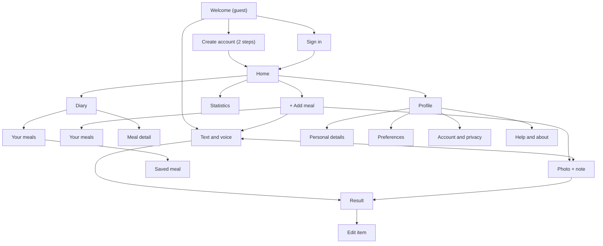
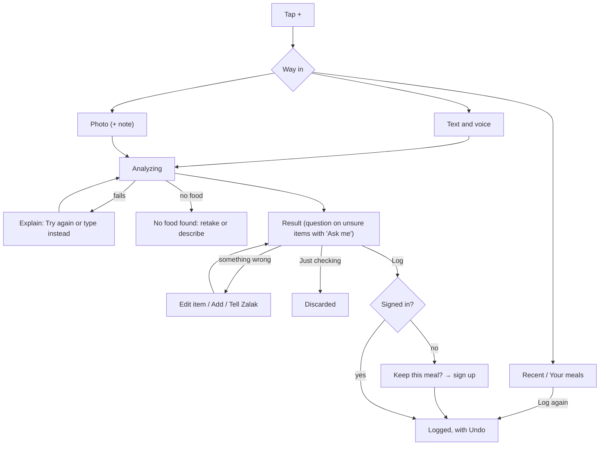

# Zalak: Structure and Interaction

How Zalak's content is organized and how users move through it (lecture 005, information architecture), and how each interaction behaves (lecture 006, interaction design). It describes the built app.

## 1. Information architecture (lecture 005)

IA looks at three things: **users** (personas in `02`), **context** (PACT in `01`) and **content** (below). The goal is that users find everything without thinking about the structure, and that logging takes as few steps as possible.

### Content inventory

**Content objects** (principle of objects: each has attributes and can be reused):
- **Meal:** photo and/or text, date and time, meal slot, food items, total range, macros, status (draft, logged, my meal), favorite flag
- **Food item:** name, amount and unit, grams, calorie and macro ranges, confidence (sure / likely / unsure), reason, question
- **My meal:** a meal saved as a template under "Your meals"; never counted as eaten
- **Profile:** name, e-mail, height, weight, year of birth, activity level; preferences (uncertainty, lighter ideas)

### Screens
- **Entry:** Welcome, Sign in, Create account (2 steps)
- **Checker:** Add meal sheet ("+"), Text and voice, Photo (camera, note, Tips), Analyzing, Result, Edit item, the error pages (Connection lost, Couldn't analyze this, No food found)
- **Home:** week strip, Eaten card, macro cards, meal slots (with "To finish" drafts); on a laptop also the week's chart
- **Diary:** day pages, Jump to a date, Meal detail, Your meals (Favorites, My meals), Saved meal
- **Statistics:** week or month
- **Profile:** Personal details, Preferences, Account and privacy (Change password, Delete account), Help and about

### Organization

- **Chronological** is the main scheme: users think in days ("what did I eat today?"). Home and the Diary are organized by date, then by meal slot or time.
- **Sequential** where order matters: the checker (input → analyzing → result → log) and sign-up.
- **Hierarchical, but shallow:** every screen is at most two taps from Home.
- **Multiple classification:** a past meal can be reached by date (Diary), by name (Your meals) or from Recent in the "+" sheet.

### Sitemap

### Navigation

**Main navigation** (principle of focused navigation: few options, each with one clear purpose):
- **Platform:** a responsive web app, mobile-first, designed at 390 × 844 (phone) and 1440 px (desktop).
- **Phone:** a bottom bar with **Home · Diary · Statistics** and a raised **"+"** in the bottom-right corner, the easiest spot for the thumb. Profile is the icon at the top right.
- **Desktop:** the same items in a left sidebar, with "+ Add a meal" and the profile at the bottom. The extra width shows more: on Result, the photo and totals on the left and the items on the right; on Home, the week's chart beside the dashboards; the Diary as an open two-page book.
- **Checker screens** (inputs, Result, Edit item, Meal detail) hide the bar and show a back or close button instead, so the task has the whole screen.

**Secondary navigation:**
- the week strip with ‹ › and "Jump to a date" (Home); page arrows and the same calendar (Diary)
- the "+" on each meal slot opens Add meal with that slot chosen
- "Use a photo instead" / "Type it instead" between the two input pages

**Guests** land on Welcome: Create account, Sign in, or "Try it without an account", which opens a small chooser (Photo / Text and voice). They see no bottom bar, because Home and the Diary have nothing to show without an account. Tapping Log asks "Keep this meal?"; after sign-up or sign-in the meal is logged.

### User flows

The core flow: checking and logging a meal.

Other flows, in steps:
- **Re-log a favorite:** + → Recent → Log again (1 tap); or Your meals → the meal → Log to lunch (NFR8, ≤2 taps).
- **Finish a draft:** Home → "To finish" in the slot → it opens where it stopped → Log.
- **Look back:** Diary → arrows or calendar → day → Meal detail → edit.
- **Change the uncertainty preference:** Profile → Preferences → "When Zalak is unsure".

### Labels

Each name is used once and the same everywhere (terminology consistency, lecture 006):
- **Home** (not "Today" or "Dashboard")
- **Diary** (not "Journal" or "History")
- **Your meals:** Favorites and My meals together, in the "+" sheet and in the Diary
- **Just checking** and **Log** as the two result actions
- **To finish** for drafts
- **Tips** for the photo tips
- confidence words: **sure, likely, unsure**

### Dan Brown's eight principles

- **Objects:** meals and food items are reusable objects (a logged meal can be logged again; a favorite is the same meal).
- **Choices:** three main destinations plus "+", and three ways into "+".
- **Disclosure:** summary first (the total range), with items, macros and reasons below; units open in a sheet.
- **Exemplars:** each input shows an example ("e.g. two eggs, toast with butter, coffee with milk").
- **Front doors:** every screen shows where you are (an active tab, a title) and a way back.
- **Multiple classification:** past meals can be found by date, by name and through Recent.
- **Focused navigation:** the bottom bar is for main places, the week strip for time, and in-page links for details.
- **Growth:** new slots, Statistics cards and preferences fit without changing the structure.

## 2. Interaction design (lecture 006)

Interaction design decides how Zalak **behaves**: how users start actions and how the system responds. Visual style is in `06`.

### The five dimensions in Zalak

- **Words:** short, action-based labels ("Log to lunch", not "Submit"). Errors say what happened and what to do next. Neutral tone: never "good/bad", "cheat" or "over the limit".
- **Visual representations:** familiar icons with a label (camera, microphone, pencil for edit, trash for delete). Confidence is an icon **and** a word, never color alone.
- **Physical space:** a phone in one hand, often while eating. Main actions sit in the bottom thumb zone, and targets are at least 44 × 44 px. On a laptop everything also works with mouse and keyboard.
- **Time:** an Analyzing screen within 1 s that says "Still working" after 8 s; a toast with Undo that stays until it is closed (a confirmation without Undo goes after 2.5 s); live totals while editing a portion.
- **Behaviour:** tap to open; bottom sheets for quick choices (Add meal, slot, unit, time, calendar); the same control does the same thing everywhere.

### Norman's principles applied

- **Visibility:** the three ways in are always visible on the "+" sheet. Result always shows which slot it will be logged to ("Log to lunch").
- **Feedback:** every tap responds within 1 s. The microphone pulses while listening and the words appear live; Analyzing shows its steps and a cookie that loses a bite per step; "Logged to lunch · Undo" confirms the save; Preferences and Meal detail say "Saved".
- **Constraints:** Analyze stays off while the text field is empty; the stepper never goes below its smallest step (¼, or 10 g) or above 5 kg; no future day can be chosen; the last item can't be deleted (Just checking drops the meal); a form is sent only once.
- **Affordances and signifiers:** each food item is a card with a pencil; the "+" is raised above the bar; dashed rows ("Add something Zalak missed", "To finish") invite an action.
- **Mapping:** the portion stepper puts − on the left and + on the right, with the kcal next to it; a "+" on a meal slot adds to that slot.
- **Consistency:** the secondary action left and the main action right at the bottom of every task screen (Just checking | Log, Re-estimate | Save changes). One save rule after logging: every change to a logged meal (items, slot, time, name, photo) saves the moment it is made. Sheets close with × or a tap outside.
- **Discoverability:** placeholder examples and detail chips in the text field, tips on first photo use, then a "Tips" button; "How to read this estimate" under every total explains the range, kcal, macros and the confidence words.
- **Conceptual model:** "the AI proposes, you decide". Nothing is saved until you tap Log (`03`, mental models).
- **Error prevention and recovery:** input is saved as a draft before analysis. Undo after Log, Delete, removing an item, Tell Zalak and Log again, and it waits until the user closes it. Nothing on Meal detail waits for a Save button, so leaving never loses a change; removing a photo asks first. A failed analysis keeps the input and offers Try again or "type it instead".

### Key interactions

**Add meal ("+")**
- A bottom sheet: the slot chips (picked from the time, with a hint that says so), three options (**Photo**, **Text and voice**, **Your meals**) and **Recent** meals with one-tap "Log again", moved with ‹ › buttons.
- Opened from the corner "+" or from a slot's "+" (slot already chosen); on a past day it logs to that day.

**Text and voice**
- One text field, detail chips ("Portion size", "How it was cooked", "Drink", "Brand") and a large microphone.
- The microphone has three states: idle ("Tap to speak"), listening (pulsing, words appear live), done (the text can be edited).
- Where voice isn't supported (Firefox, plain http), the microphone is hidden and the field still works.

**Photo**
- Phones: a live camera with a shutter, Upload and Tips; the phone's own camera when live access isn't possible. Laptops: drag, choose or paste a photo.
- Then an optional note ("Anything the photo can't show?") with chips like "Cooked in oil" and "Shared dish".
- The first time on a phone, three swipeable tips open by themselves, with "Don't show these tips again".

**Analyzing**
- Appears at once: "Zalak is taking a bite…", three named steps, a progress bar, and the cookie losing a bite per step. After 8 s the line under the title says "Still working. You can cancel: what you added is kept."
- Cancel is always there. The draft is kept and waits on Home under "To finish".

**Clarifying question** (only with "Ask me")
- On the unsure item itself: its reason and one question, answered with **A little / About that / A lot** (half, the same, or one and a half of Zalak's portion). "Best guess" keeps the reason and hides the question.

**Result**
- From top to bottom: the photo or text, the slot, the meal's name, the **total range** (largest), a short neutral description, macro bars (solid to the lowest estimate, lighter to the highest) and under them "How to read this estimate", the lighter idea if any, then "What Zalak saw".
- Each item shows its name, portion, calorie range and confidence; unsure items add the reason (and the question).
- Under the items: "Add something Zalak missed" and "Something else wrong? Tell Zalak" (typed or spoken).
- Fixed at the bottom: **Just checking** and **Log to [slot]**, and "Estimate, not medical advice".

**Edit item**
- A page: the name, the amount stepper (tap the number to type it) with the unit under it (tap to open the unit sheet: Portion, Weight, Volume, Kitchen, and bowl sizes), the gram equivalent, the kcal for this portion (with "was …" once changed), and the macros.
- **Reset** brings back Zalak's estimate; **Re-estimate** asks Zalak again for the name and amount on screen; **Save changes**; **Delete item** (with Undo).

**Log**
- "Logged to lunch · Undo", on Home for the meal's day, where the meal appears in its slot. The message stays until it is closed, and it is the first thing the Tab key reaches.
- A guest gets "Keep this meal?"; the checked meal is logged once the account exists.

**Meal detail** (a logged meal)
- The same layout as Result, plus the heart (Favorites), the time (a sheet with an hour and minute wheel), the name, and Add / Replace / Remove photo.
- Every change saves the moment it is made: items as before, the slot when picked, the time on Done, the name with "Save name", a photo when chosen; "Saved" appears under the pills. At the bottom: **Log again** and **Delete meal** (red, with Undo).

**Errors** (calm, ink on a soft tint, never red)
- Connection lost: "Zalak couldn't reach its AI just now. Your meal is saved as a draft, nothing is lost." → Try again / Edit the text.
- AI failure: "Couldn't analyze this" → Try again / Edit the text (or Describe it instead, for a photo).
- No food found: what Zalak saw in the photo, tips for the next photo → Take another photo / Describe it instead.
- Straight after a failure, the Analyzing screen first shows which step failed, then fades to the page.

### Feedback channels

**Visual** only, for every action: state changes, the Analyzing screen and toasts. Sound and vibration were dropped (D10): the visual feedback is enough, and silence suits eating with others.

### Common mistakes avoided

The lecture lists four common mistakes, and each one has an answer here:
- **Lack of feedback:** every action responds within 1 s.
- **Hidden functionality:** pencils on items, visible inputs, no long-press-only actions.
- **Inconsistent controls:** fixed action positions and one label per thing.
- **Overly complex interactions:** at most 2 taps to the main tasks, and editing is free, not a wizard.
